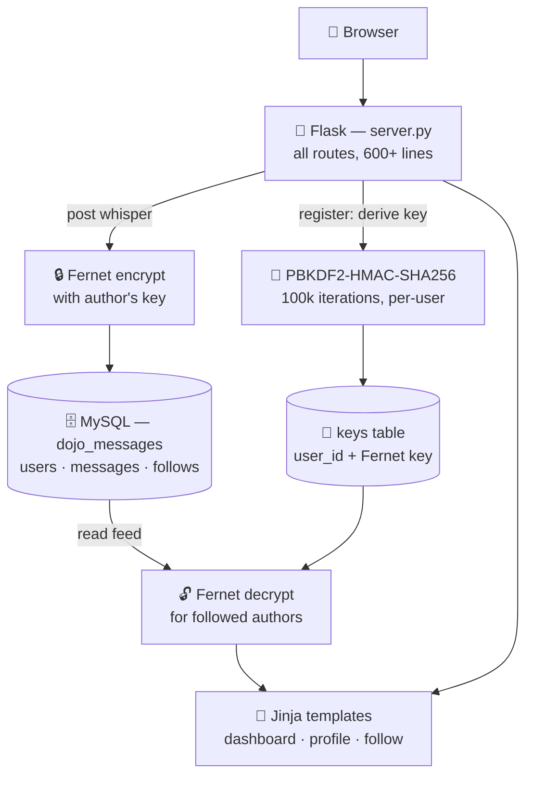

# 🥷 Dojo Room

> A small social app built as a Coding Dojo group project (Chad, Ivan, and Daniel, January 2020): register, post short **whispers** to your dashboard, follow other users ("ninjas"), and visit their profiles — with one twist: whispers are stored **Fernet-encrypted** under a per-user key derived at registration.

**Status: archival coursework.** Kept as a record of the group project; commits since 2020 are automated dependency fixes (Snyk).

---

## 📑 Table of Contents

- [🏗️ Architecture](#️-architecture)
- [✨ Features](#-features)
- [🔐 Encrypted Whispers](#-encrypted-whispers)
- [🗄️ Database](#️-database)
- [🚀 Running Locally](#-running-locally)

---

## 🏗️ Architecture

A single-file Flask monolith backed by MySQL. At registration each user gets their own Fernet key, derived from their email with PBKDF2 and stored in a `keys` table; whispers are encrypted with the author's key on the way in and decrypted for display on the way out.



**Components:**

- 🐍 **`server.py`** — every route: auth, dashboard feed, whispers, follows, profiles, bio editing, image upload, contact page
- 🗄️ **`mysqlconnection.py`** — the Coding Dojo MySQL helper (PyMySQL)
- 🧾 **`templates/`** — `index` (welcome/login), `dashboard`, `profile`, `follow`, `update_bio`, `contact`
- 🖼️ **`static/images/`** — bundled imagery for the welcome and profile pages

---

## ✨ Features

- 📝 Registration and login with bcrypt-hashed passwords and session auth
- 💬 **Whispers** — short posts on your dashboard; delete your own
- 🥷 **Follow system** — a "ninjas" page lists users to follow/unfollow; your feed surfaces followed authors
- 👤 **Profiles** — per-user profile pages with whispers, an editable bio (including a JSON bio-update endpoint), and profile image upload
- ✉️ A contact page for the (fictional) Dojo Room team

---

## 🔐 Encrypted Whispers

At registration, the app derives a 32-byte key from the user's email using PBKDF2-HMAC-SHA256 (100,000 iterations, random salt), base64-encodes it, and stores it in the `keys` table next to the user ID. Posting a whisper encrypts the text with [Fernet](https://cryptography.io/en/latest/fernet/) under the author's key; rendering a dashboard decrypts each followed author's messages with their stored key.

Honest caveat, as a coursework experiment: the keys live in the same database as the ciphertext, so this demonstrates the encryption mechanics rather than providing real confidentiality against anyone with database access.

---

## 🗄️ Database

Two SQL dumps are included: [`chad_ivan_daniel_group_project_data.sql`](chad_ivan_daniel_group_project_data.sql) (schema + sample data) and [`chad_ivan_daniel_group_project_nodata.sql`](chad_ivan_daniel_group_project_nodata.sql) (schema only). The ERD model is [`chad_ivan_daniel_group_project.mwb`](chad_ivan_daniel_group_project.mwb).

---

## 🚀 Running Locally

Prerequisites: Python 3 and a MySQL server with one of the included dumps imported.

```bash
pip install -r requirements.txt
python server.py
```

Then open [http://127.0.0.1:5000](http://127.0.0.1:5000). The MySQL credentials in `mysqlconnection.py` are the course-template defaults — adjust them to your local MySQL setup.
